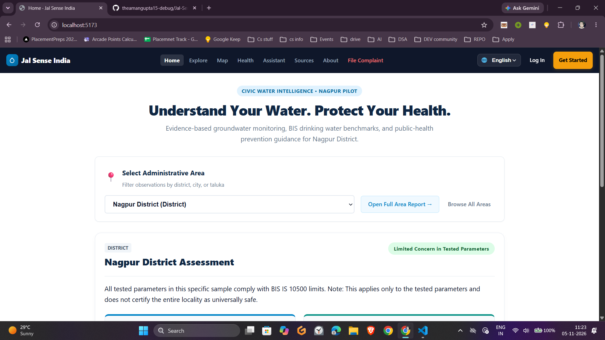
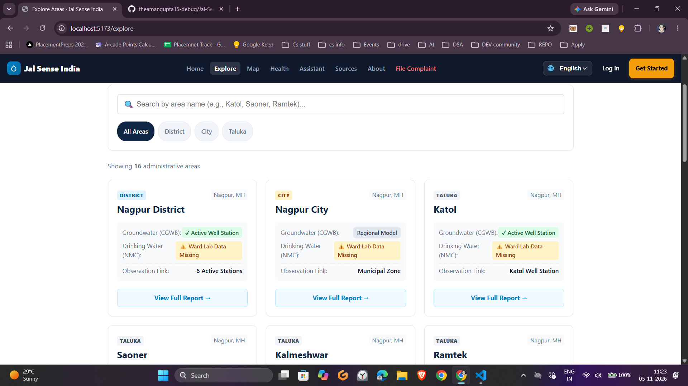
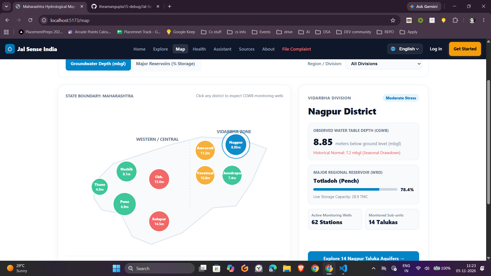
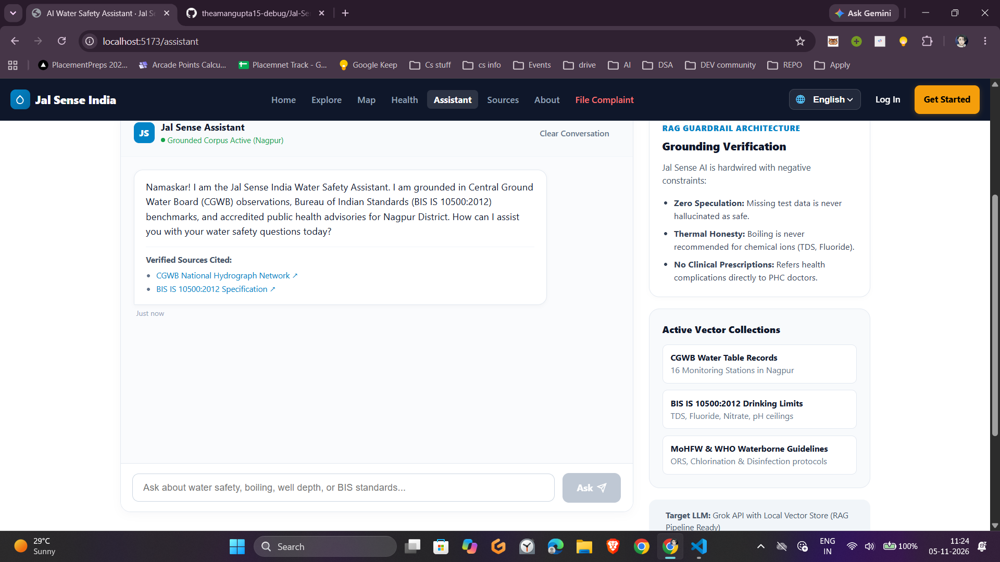

# 💧 Jal Sense India (Nagpur Pilot)
> **Open Civic Water Intelligence, Aquifer Transparency & Municipal Accountability Platform**

Jal Sense India is an open-source civic technology platform developed to bridge the critical gap between official environmental datasets and citizen accessibility. Focusing on Nagpur District across 16 administrative sub-units and talukas, the platform organizes disparate public data streams—hydrogeological observations, statutory drinking water limits, regional reservoir levels, and public health guidance—into a clean, verifiable interface.

---

## 🎯 The Civic Problem
In many administrative divisions across India, essential water metrics remain buried inside quarterly PDFs, static state gazettes, and fragmented portals. Citizens frequently face:
1. **Ambiguity Around Water Safety:** Lack of laboratory sample records is often mistakenly conflated with certification of potability.
2. **Thermal Disinfection Misconceptions:** Widespread belief that boiling removes chemical ions (such as Fluoride, Nitrate, or high TDS), whereas thermal boiling only addresses biological pathogens.
3. **Barriers to Civic Reporting:** Opaque municipal grievance processes that require excessive KYC credentials just to inspect data or log a pipeline issue.

---

## 🛠️ Core Capabilities & Architecture

- **Open Access Data Exploration (No Mandatory Login):** Citizens can freely explore all 16 Nagpur talukas, inspect monitoring well depths, and verify parameters against Bureau of Indian Standards (BIS IS 10500:2012) without creating an account or logging in.
- **Action-Gated Authentication:** Authentication is triggered strictly for state-modifying actions (e.g., lodging a municipal grievance or submitting feedback for data provenance audits), with distinct role support for **Citizens** and **PHED / Municipal Officials**.
- **Hydrological vs. Potability Data Separation:** Enforces strict civic honesty rules: static groundwater tables (CGWB) and laboratory water quality testing (BIS) are strictly demarcated and never combined into misleading composite scores.
- **Maharashtra Geospatial Hydrology Map:** Visualizes Central Ground Water Board (CGWB) aquifer table depths (mbgl) and Water Resources Department (WRD) major reservoir capacities across divisions with deep-dive focus on Vidarbha.
- **Municipal Grievance Redressal:** A structured reporting portal for pipeline bursts, sewage intrusion, illegal borewell drilling, and waterborne outbreaks, complete with ticket ID generation and 24x7 helpline escalation pathways.
- **Multilingual Support (EN / HI / MR):** Built with dynamic language switching across English, हिंदी (Hindi), and मराठी (Marathi) to ensure accessibility across rural and urban demographics.
- **Local AI Civic Water Assistant (Ollama Engine):** Powered by an on-device local LLM (`llama3.2:1b` via Ollama) with strict negative guardrails:
  - **Zero Hallucination:** Transparently notes absence of data rather than inventing lab metrics.
  - **Thermal Honesty:** Clarifies that boiling eliminates microbial pathogens but does not remove chemical contaminants like Fluoride, Nitrate, or TDS.
  - **Clinical Boundaries:** Directs citizens experiencing acute symptoms to Primary Health Centres (PHCs) or GMCH Nagpur while providing basic hydration (ORS) advice.
  - **Fallback Engine:** Gracefully falls back to a grounded rule-based knowledge base if the local Ollama instance is offline.

---

## 📂 Project File Structure

```text
jal-sense-india/
├── public/
│   ├── favicon.ico
│   └── vite.svg
├── src/
│   ├── assets/                 # Icons, badges, and static vector graphics
│   ├── components/             # Reusable UI elements
│   │   ├── ProtectedRoute.jsx  # Guards complaint action routes
│   │   ├── StatCard.jsx        # Dashboard metric blocks
│   │   └── WaterTable.jsx      # BIS IS 10500 parameter comparison table
│   ├── context/                # Global state management
│   │   ├── AuthContext.jsx     # Citizen/Official session handling & localStorage
│   │   └── UIContext.jsx       # Light/Dark mode state and multilingual active locale
│   ├── data/                   # Grounded civic benchmarks and hydrogeological data
│   │   ├── locations.json      # 16 Nagpur sub-units, talukas, and CGWB well profiles
│   │   ├── standards.json      # BIS IS 10500 statutory thresholds (pH, TDS, F, NO3)
│   │   └── healthGuide.json    # Waterborne ailments, symptoms, and disinfection protocols
│   ├── pages/                  # Route views
│   │   ├── AboutPage.jsx       # Civic-tech mission, disclaimers, and project scope
│   │   ├── Assistant.jsx       # AI Water Assistant (Local Ollama llama3.2:1b integration)
│   │   ├── ComplaintPage.jsx   # Municipal grievance redressal form (Auth-gated)
│   │   ├── Explore.jsx         # Directory & search for all Nagpur administrative areas
│   │   ├── HealthPage.jsx      # Epidemiological guide & point-of-use disinfection rules
│   │   ├── Home.jsx            # District hero summary, quick-select & health banner
│   │   ├── LocationPage.jsx    # Deep-dive taluka report (Aquifer mbgl + BIS lab metrics)
│   │   ├── LoginPage.jsx       # Returning user authentication (Citizen vs. Official)
│   │   ├── MapPage.jsx         # Maharashtra regional capacity & reservoir level viewer
│   │   ├── MethodologyPage.jsx # Data provenance, CGWB hydrograph sources & limits
│   │   └── RegisterPage.jsx    # New citizen registration & taluka assignment
│   ├── utils/
│   │   └── translator.js       # Tri-lingual dictionary (EN, HI, MR) & DOM parser
│   ├── App.css                 # Clean overrides
│   ├── App.jsx                 # Central router, navbar controls, and layout shell
│   ├── index.css               # Design tokens, CSS variables, Light/Dark styling
│   └── main.jsx                # Application mounting root
├── .gitignore
├── index.html
├── package.json
└── vite.config.js


## 📸 Platform Interface Preview

| Home Overview | Explore Talukas |
| :---: | :---: |
|  |  |

| Maharashtra Hydrological Map | Local Ollama AI Assistant |
| :---: | :---: |
|  |  |


Technology Stack
Frontend Client
Framework: React 18+ (Hooks, Context API)

Build Tooling: Vite

Routing: React Router v6 (Dynamic route matching, protected routes)

Styling: Modular theme-aware CSS Variables (--bg-card, --text-main, --primary, --border-color) supporting light and dark themes with zero heavy UI libraries

Localization: Trilingual dictionary support for English, हिंदी, and मराठी

AI Assistant & Data Layer
Local Inference: Ollama running llama3.2:1b locally on http://localhost:11434

Civic System Grounding: Hydrogeological grounding and thermal honesty constraints passed into the model prompt

Offline Resilience: Built-in heuristic fallback engine ensuring continuous operation without active LLM processes

Data Provenance: Central Ground Water Board (CGWB) observation wells, BIS IS 10500:2012 drinking water standards, and Water Resources Department (WRD) Maharashtra reservoir metrics

1. Clone & Install Dependencies
Bash
git clone [https://github.com/your-username/jal-sense-india.git](https://github.com/your-username/jal-sense-india.git)
cd jal-sense-india
npm install
2. Set Up Local Ollama Engine
Make sure Ollama is installed on your machine and pull the model:

Bash
ollama pull llama3.2:1b
Configure CORS origin so your Vite app can communicate with Ollama:

Windows (PowerShell):

PowerShell
[System.Environment]::SetEnvironmentVariable('OLLAMA_ORIGINS', 'http://localhost:5173,[http://127.0.0.1:5173](http://127.0.0.1:5173)', 'User')
macOS / Linux:

Bash
OLLAMA_ORIGINS="http://localhost:5173" ollama serve
3. Run Development Server
Bash
npm run dev
Open http://localhost:5173 in your browser.

---

### Step 2: Push Your Changes to GitHub

Run the following commands in your project root terminal (VS Code Git Bash or PowerShell):

```bash
# 1. Check changed files
git status

# 2. Stage all modifications (README, Assistant, Map, Auth pages)
git add .

# 3. Commit with a clear message
git commit -m "feat: integrate local Ollama (llama3.2:1b) assistant, interactive Maharashtra map, and updated docs"

# 4. Push to your GitHub repository
git push origin main